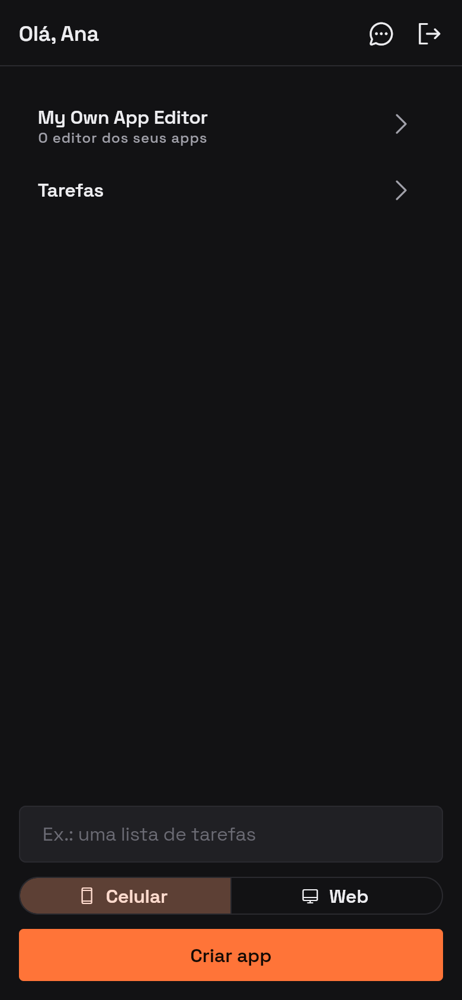
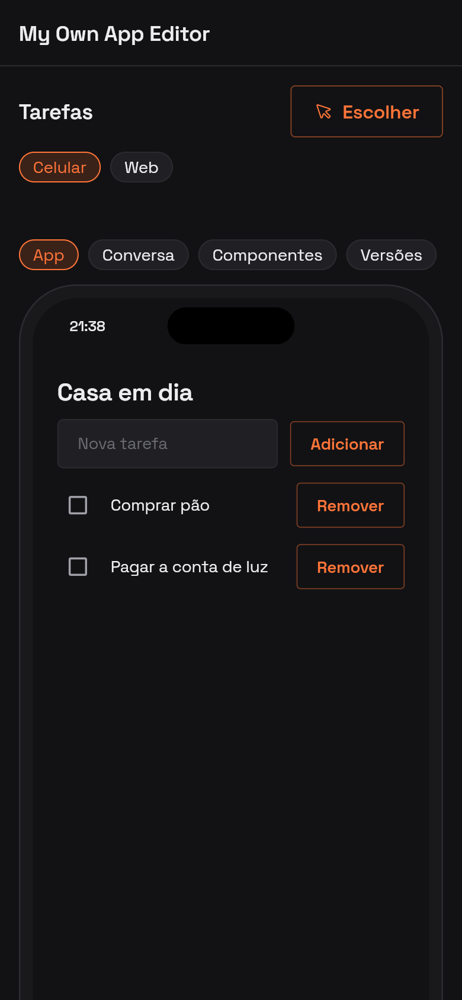
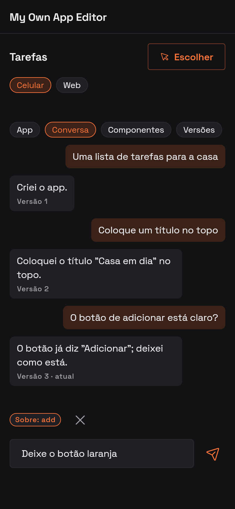
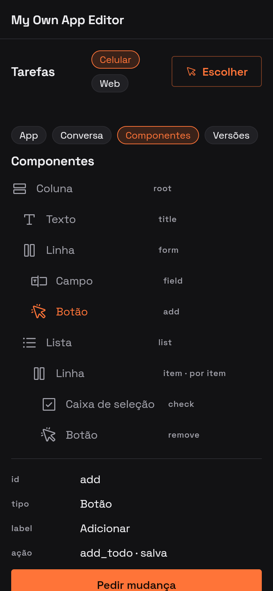
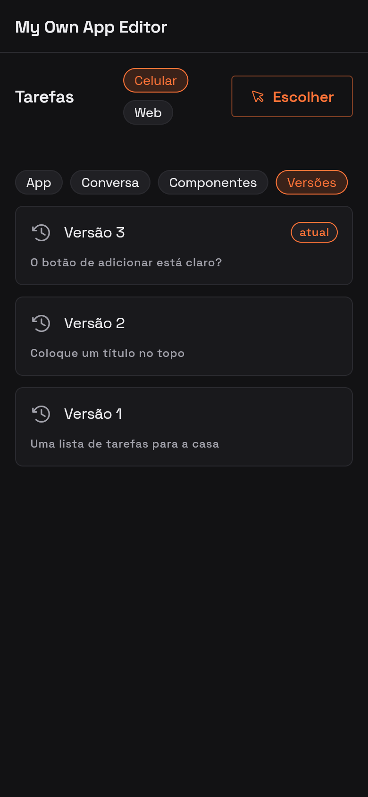
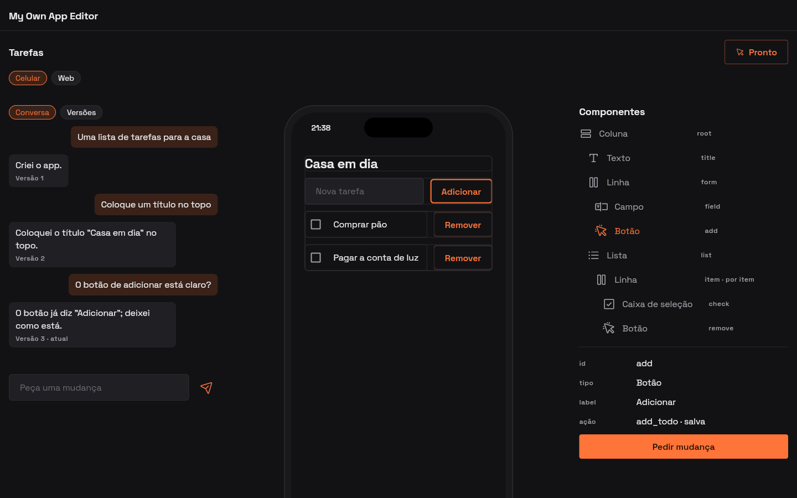

# The editor, built with itself

## 1. The prompt

> now i want to explode this app. Lets amplify the catalog so we can build
> your own app using the same core engine of itself.

> we should have a switch between web and mobile app on what we are editing.

> disconsider mockup now

> so basically we have a project called my own app editor by default, and it
> is the editor itself.

> and when loading the my own web app it opens it as rendered on the editor and
> also makes available to edit it

> great

> is the pannel, versioning etc, icons gonna work with this approach?

> make sure the existing editor (not the selector menu, home screen) is made
> with a2ui components and dart code instead of plain widgets and bloc. Fill in
> any gaps necessary (requests, etc)

> limit is close to be reached, lets speed

> is 92% ok to spend on this? or maybe not enough

> now that the limit is available proceed with the stage 5

## 2. The plan

**The goal.** Every account starts with one project, **My Own App Editor**.
It is an ordinary bundle (`ui`, `data`, Dart `actions`), drawn by
`AppRenderer` and run by `action_runner`, like any other app. It is the
editor: the list of apps, a field that creates one, the conversation that
changes one, the app running in a phone or browser frame, the versions.
Since it is an app, it can be opened in itself and changed by talking to it.

Four things the engine doesn't have yet:

1. **A bigger catalog.** Today there are 7 components; the editor needs about 20.
2. **Embedding.** An app can draw *another* app, live.
3. **Platform calls.** A saved action can reach the person's own apps:
   list, create, change, restore.
4. **A form.** Each app targets `mobile` or `web`, set with a switch in the
   studio.

### Approach

**1. Catalog v2.** This follows the names and properties of the A2UI v0.9
basic catalog. Every addition is optional, so apps already built keep
drawing exactly as they do now.

| Group | Components (new in bold) |
|-------|--------------------------|
| Layout | Column, Row (+ `justify`, `align`, child `weight`), List (+ `direction`), **Card**, **Divider**, **Tabs**, **Modal**, **Pages** (ours: `current` bound to data, `pages` name → id; this is how navigation works) |
| Display | Text (variants `h1`–`h3`, `body`, `caption`, plus `tone`: `muted`/`accent`/`negative`), **Icon** (a closed set of about 48 names mapped in `AppIcons`), **Image** (`url`, `fit`, `variant`: avatar/feature), **Badge**, **Message** (ours: a chat bubble, `role` is `me`/`other`, with `text` and `caption`) |
| Input | TextField (+ `variant` longText/number/obscured, and `action` that runs on submit), CheckBox, **Switch**, **ChoicePicker** (chips or list, single or multiple), **Slider**, **DateTimeInput**, Button (+ `variant` primary/default/borderless, and `icon`) |
| Engine | **Surface** (ours, below) |

- `onEdit(path, value)` takes `Object?` instead of a String, because sliders,
  switches and choices write numbers, booleans and lists. All of this is
  device-only state, and the existing rule still holds: a saved action reads it
  from the event's context.
- Each component lives in exactly 3 places: `COMPONENTS` + `parseBundle`
  rules (`bundle.ts`), `AppRenderer`, and `RULES` (one line each). The
  inspector also gets an icon and a property row for each one.
- `AppRenderer` is about 280 lines now and would grow past 1k with all of
  these, so it splits into `app/lib/apps/components/`, one file per group.
  `app_renderer.dart` keeps the scope, the binding and the selection.

**2. Surface: an app inside an app.** `{"component": "Surface", "app":
{"path": "/editing/id"}, "selectable": true, "frame": "auto"}` draws the
app with that id, full and live. It has its own `AppRunCubit`, its own
bytecode run by the same `client_runner`, its own server actions, and its own
`rev`. The host only picks *which* app to show. With `selectable`, a tap picks
a component and fires the host's `select` action with `{componentId}`.
`frame` draws it in `AppPhoneFrame` or the new `AppBrowserFrame`,
depending on that app's form. A Surface inside a Surface draws a
placeholder, so an app can't nest itself without end.

**3. Platform calls.** A *server* action gets new names for its `call`:
`apps.list`, `apps.get`, `apps.create {prompt}`, `apps.send {id, prompt,
focus}`, `apps.history {id}`, `apps.restore {id, n}`, `apps.setForm {id,
form}`. They run in Nest and are scoped to the person who tapped, through
the same `AppsService` the REST routes use. They don't touch the data
document. Instead, `call` resolves to the result, and the action writes what
it needs into its patch (for example, the new app's summary appended to
`/apps`). The runner protocol gets one new message (`call` → Nest →
reply), in `runner.ts` and `runner/`. A client action can only reach these
through a server action, and the existing `call` rule already guarantees that.
These calls can take as long as a build, so the step budget pauses while one is
in flight, and the action's timeout grows to cover `BUILD_TIMEOUT_MS`.

**4. Form: mobile or web.** `generated_app.form` is `'mobile' |
'web'`, defaults to `mobile`, and is kept in each version. In the studio's app
bar, a switch (**Celular | Web**, `AppIcons.formMobile`/`formWeb`) calls
`PATCH /api/apps/:id { form }`. That makes a version ("Agora é um app para
web") without the model. The form changes three things:
- the frame: a phone (390 wide), or a browser window (`AppBrowserFrame`,
  up to 1280 wide) in the studio;
- the run screen: a web app fills the window up to `maxContentWidth`
  with no phone frame; a mobile one keeps today's behaviour;
- both prompts: `BUILD_PROMPT` and `EDIT_PROMPT` get one line about the form
  (web: wide, rows and a side navigation in `Pages`; mobile: one column).
  Create takes `{prompt, form}` too, and the home's create field gets the
  same switch.

**5. The default project.** `server/src/apps/editor/editor.bundle.json`
holds the editor, written by us, not generated: a home with an app list of
Cards (each with an Icon and a form Badge), a create field with the form
switch, then the studio as `Pages`. The studio has Tabs (Conversa ·
Componentes · Versões), Messages, a Surface with `selectable`, and the
Celular | Web switch. Its actions are written by hand in Dart and call the
platform. Each person gets a copy, seeded the first time `GET /api/apps` sees
none (`seed: 'editor'`, marked `system` in the list). A copy is theirs to change
by talking to it. `npm run apps:rebuild -- --editor` re-seeds it from the file
(a new version, so the old one can be restored).

**6. What the editor needs that a small app doesn't** (found by walking
the studio's panel, versions and icons through the engine):

| Editor piece | How it's built with the engine | Gap it needs filled (step) |
|--------------|-------------------------------|------------------------|
| Component tree (panel) | `apps.get` puts the edited app's `ui` in data; a Dart action flattens it into `/tree` rows (`id`, type, depth, icon name); a List draws them | **`inset`** on any component, bound per row (depth × `treeIndent`) (1) |
| Picking in the app | Surface `selectable`; a tap fires the editor's `select {componentId}` | Surface **`selected`** (outline the picked one) and **`picking`** (bound on/off) (4) |
| Picked component's menu | `select` fills `/picked` from the edited `ui`; Text rows | **`visible`** on any component, so the menu only shows when something is picked (1) |
| Conversation + "pensando…" | Messages over `/versions`; Enviar → `apps.send` | **`/$pending/<action>`**, a read-only virtual path holding the event of an action in flight, so the request bubble and the typing dots show during a 30 s call (3) |
| Versions, look at one, restore | `apps.history` → Cards with a Badge "atual"; Restaurar → `apps.restore` | Surface **`version`** (show one version, read-only) (4) |
| Three columns on web, sheet on phone | Row with weights; Pages on mobile | **`/$viewport/width`**, a virtual read-only path, plus `visible` to pick a layout (1) |
| Icons: component types, cursor, tree, version, restore, Celular/Web | Icon by name | the closed set includes **every icon the studio uses** (1) |
| Actions that call `apps.*` | — | they can't run on the device first (there's no copy of your other apps there, and running twice would create twice), so a new **`"on": "platform"`**: server-only, and the device waits, showing `/$pending` (3) |

When the editor edits itself, the change takes effect when it reloads (a
"Recarregar" banner), not mid-tap. A Surface of itself draws the
placeholder one level down.

### Rollout (each step lands on main working)

| Step | What ships | Visible |
|------|-----------|---------|
| 1 | Catalog v2, the renderer split, the inspector rows, the prompts | built apps can use the new components |
| 2 | Form: column, PATCH route, studio switch, AppBrowserFrame, prompts | Celular / Web |
| 3 | Platform calls (runner protocol + `AppsService`) | — (tests) |
| 4 | Surface | an app can draw another |
| 5 | The editor bundle, seeded per account; opening any app opens it; the native studio is removed | **the studio *is* My Own App Editor** |

### References

- A2UI v0.9 basic catalog
  (<https://a2ui.org/specification/v0_9/catalogs/basic/catalog.json>): the
  18 components and their properties. Names and props follow it, and ours
  (Pages, Message, Badge, Switch, Surface) are the only exceptions.
- A2UI v0.9 spec (<https://a2ui.org/specification/v0.9-a2ui/>): surfaces,
  data binding by JSON Pointer, `weight` on every component.
- `product/spec/actions.md`: the `call` contract and the runner protocol
  that platform calls extend.
- `product/spec/studio.md`: what the editor bundle has to match.

### Decisions

| # | Decision | Chosen | Why |
|---|----------|--------|-----|
| 1 | The native studio | **Replaced** by the editor bundle (`StudioChat`, `StudioInspector`, `StudioCubit`, the studio half of `AppRunPage` go). The home and the app list stay native | Asked for directly. The way back from a broken editor: the home's menu on the editor's card, **Restaurar editor** (re-seed from the file as a new version), and if the editor fails to load, the app opens plain (`AppRunPage` without the studio) with that same button |
| 2 | The default editor: shared or a copy | **A copy per account** | It is "your own" app; changing it must not touch anyone else's |
| 3 | Can built apps call the model | **Only through `apps.*`** (create, send) | No raw `ask` call: cost and abuse stay behind the same routes, limits and `ALLOWED_EMAILS` gate as today |
| 4 | How a Surface's app runs | **Its own cubit, bytecode and server actions** | The same engine, not a re-implementation in the host's Dart |
| 5 | Form: stored or preview-only | **Stored and versioned** | It changes what the model builds, not just the frame |
| 6 | Icons | **Closed set of about 48 names** | The model can't ask for an icon we don't ship; an unknown name draws nothing |
| 7 | Image sources | **https URLs only**, no uploads | Uploads are a feature of their own |
| 8 | Video, AudioPlayer, Modal's `trigger` | Video and Audio **left out**; Modal opens from a bound `open` flag | Neither is needed for the editor; a bound flag fits actions-as-patches better than a trigger |
| 9 | What opening an app opens | **The editor bundle**, with that app in its Surface (`/apps/:id` runs the editor with `/editing/id` seeded). The editor is on the home too ("My Own App Editor", first); opening it edits the editor with itself | Asked for directly ("opens it as rendered on the editor and makes it available to edit") |
| 10 | `runnerVersion` | **Bumped** in step 3 (new protocol message) | Bytecode isn't portable; old apps get recompiled when read, as today |

### Open questions

- Should the seeded editor be **locked**? No: Restaurar editor is the way back (decision 1).

### How it will be proved

- `npm test`: `parseBundle` accepts every new component and refuses bad
  props; `editor.bundle.json` parses and every action compiles; each platform
  call answers only the caller's apps (two users); the `PATCH` form route
  makes a version.
- `dart test` in `runner/`: a `call('apps.list')` round trip, and the
  step budget pausing across the call.
- `flutter test`: one widget test per component group; Surface drawing
  another app's snapshot and forwarding a pick; a nested Surface showing its
  placeholder.
- Prints (the plan's UI touch), shot from a preview entry point against fakes:
  the editor's home, its studio with the Surface (mobile), and the same app
  switched to web.
- `flutter test`: the router opens `/` on the editor's snapshot, and falls back to the native home when it fails to load.
- One real run against the model: create a web app *from inside the editor*,
  then change it from the editor's conversation.

## 3. What was built

The editor, real bundle, real renderer, prints of the build (preview entry
point against fakes; the editor's data dumped from the server harness after
real platform calls, then deleted):

| | |
|---|---|
|  |  |
| 1 Home: the editor first, Celular / Web on create | 2 Editor on a phone, App tab: the to-do app running in a Surface |
|  |  |
| 3 Conversa: versions as turns, a component in focus | 4 Componentes: the tree (`inset`, `component:` icons), the picked button's menu |
|  | |
| 5 Versões, newest first | |

6 A wide window (`/$viewport/size` = expanded): conversation · app · components, picking on, `add` outlined.

**The rule that matters.** The studio is data: `server/src/apps/editor/editor.ts`
(21-component catalog, 11 Dart actions, 4 of them platform). Opening an app
runs the person's editor with `start {id}`; the native studio
(`studio_chat`, `studio_inspector`, `studio_cubit`) is deleted.

**Server.** `catalog.ts` (components, icons, references), `form`
(`0003_app_form.sql`, `PATCH /api/apps/:id`), `seed` (`0004_app_seed.sql`),
`platform.ts` (8 calls, limits, Portuguese refusals), `runner.ts` (calls back
from a run, clock paused), `editor/editor.ts`, `GET /api/apps/editor`,
`POST /api/apps/editor/reset`, two analytics rows, prompts (catalog,
`visible`, `$viewport`, `$pending`, `start`, platform in `EDIT_PROMPT`).

**Runner.** Concurrent JSON-lines protocol with `call`/`answer`;
`call` untyped (a dart_eval type check refused maps built from data);
the compiler warmed once per process (dart_eval failed the first program of
a process reading `.length` on a typed value: that likely failed the first
build after every restart, hidden by the retry). `runnerVersion` `+call.2`.

**App.** `AppRenderer` split into `components/{layout,display,input,surface}.dart`,
`AppBrowserFrame`, `AppRunCubit` (`platform`, `pending`, `source`, `start`),
`AppRunPage` (editor, fallback), home (editor caption, form on create).

**Tests.** Server 62 → see check below (new: `catalog.spec` 11, `form.spec`
5, `platform.spec` 6, `editor.spec` 9, on PGlite with the real runner and a
scripted model); runner 11; app: catalog, form, surface, run page, cubit
(platform, pending, start). No flaky test seen.

**Where it differs from the plan.**
- The bundle is a TS module, not `editor.bundle.json`: the Dart helpers are
  written once and prepended to each action (the runner has no imports).
- The editor shows its own name in the app bar and the edited app's in its
  header; the home stays native, as asked.
- Engine additions the editor needed, beyond the plan: `visible` truthy /
  `is` / `not`, `action` on Row and Column, Icon `component:<Type>`,
  `/$viewport/size`, an action named `start`, Surface `revision`.
- `npm run apps:rebuild -- --editor` is not written: Restaurar editor
  (per person) covers it.
- When the editor edits itself, the change shows the next time it opens.

## 4. How to turn it on

Nothing to set. Migrations `0003`/`0004` run on boot; each person's editor
is made the first time they open an app. Without `OPENROUTER_API_KEY` the
editor opens and runs apps; sending a change refuses with "O assistente
ainda não está conectado a um modelo."

## 5. Cost and time

| Session | What | USD |
|---------|------|-----|
| 1 | plan, steps 1–4 | 8.96 |
| 2 | step 5, prints, docs | 8.06 |
| | **total** | **17.01** |

USD from `mcp__usage-bars__session_cost`; it includes the talk and two
waits on the usage limit. No OpenRouter calls: every model reply in the
tests and prints is scripted. Never run against a real model.
