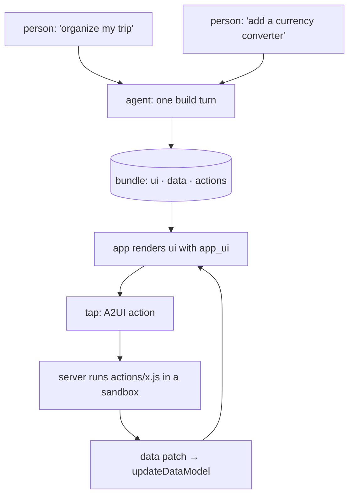
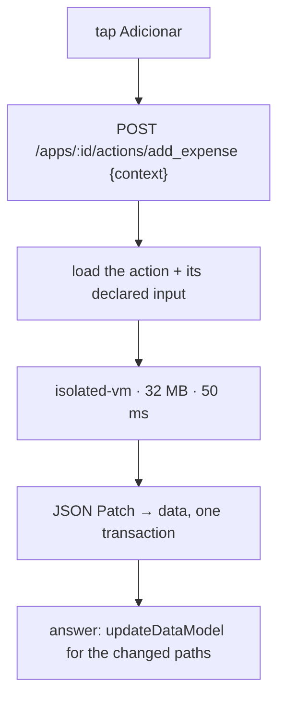
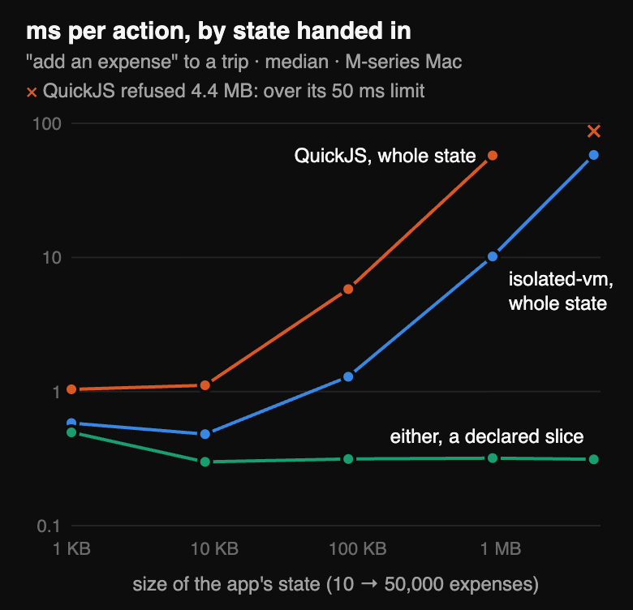
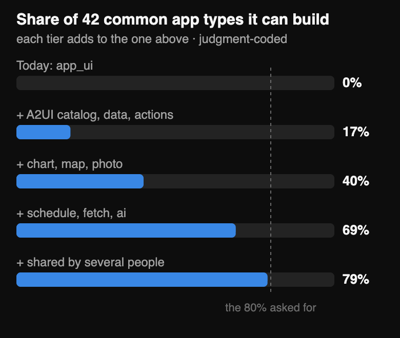

# An app is three stored files: screen, data and actions

2026-11-01 · RFC · draft (phases 1–3; deep-research pass not run) · server assistant, a new `apps` module, `app_ui`, a new renderer · [issue #1](https://github.com/pietroid/my_own_app/issues/1)

## The agent builds an app once; then the app runs without it

> [!IMPORTANT]
> Yes, with three corrections. An app is a **stored bundle**: an A2UI screen (`ui`), a JSON document (`data`) and small JS functions (`actions`). A tap runs an action on the server with **no model call**; the agent comes back only for a change. (1) The catalog to "translate" has **2 widgets**: build it first. (2) An action gets **only the data it declares** and returns a patch. (3) Actions run in **isolated-vm**, never `eval`. Four tiers reach **79% of 42 app types**.



- **Do:** the bundle tables, an action runner, an A2UI v0.9 renderer over `app_ui`, a catalog of about 22 components, the `edit_app` tool.
- **Not needed:** a model call per tap, generated Flutter or HTML code, `genui`, the whole state in every action.
- **You decide:** whether an app can be shared with other people (tier 4, the last 10 points).

## Today the assistant only talks, and keeps nothing

[`assistant.service.ts:41`](../../../server/src/assistant/assistant.service.ts) calls the model with an empty tool list:

```ts
const outcome = await this._model.generate(
  [{ role: 'system', content: systemPrompt(user) }, ...messages],
  [],
);
// With no tools offered, the model can only answer in words.
```

| Part | Today | Where |
|---|---|---|
| What the agent can do | answer in text | `assistant.service.ts:43` |
| What is stored | nothing: the schema has Better Auth's 4 tables only | `schema.ts:94` |
| Where the conversation lives | in memory, while the page is open | `assistant_cubit.dart:38` |
| What home shows | one empty state and a button | `home_page.dart:41` |

The seam is ready, though. `OpenRouterClient.generate` already takes tools and returns `tool_calls` ([`openrouter.client.ts:126`](../../../server/src/assistant/openrouter.client.ts)).

## The catalog to translate has two widgets

[`code/catalog.mjs`](code/catalog.mjs) compares `app_ui`'s widgets with the 18 components of A2UI's v0.9 basic catalog ([data](data/catalog.csv)):

| A2UI basic catalog (18) | In `app_ui` |
|---|---|
| Button, Icon | ✓ `AppButton`, `AppIcon` |
| Text, Row, Column, Card, List, Divider, Tabs, Modal | ✗ (screens use Flutter's own, styled by the theme) |
| TextField, CheckBox, ChoicePicker, Slider, DateTimeInput | ✗ |
| Image, Video, AudioPlayer | ✗ |

- `AppEmptyState` is the third widget. In A2UI it is a Column holding a Text and a Button.
- So "translate the catalog" means **write about 20 widgets**, each one a design-system widget with tokens, plus its JSON schema. That is the bulk of the work, not the protocol.
- A travel page needs three more that A2UI's basic catalog lacks: **Map, Chart and PhotoPicker**.

## Example: "organize my trip to Lisbon" becomes a bundle

Today the answer is a paragraph. With bundles, one build turn writes three things. The screen binds to data by path and names actions; it holds no values and no code:

```json
{ "id": "spent", "component": "Text",
  "text": { "call": "formatCurrency",
    "args": { "value":
      { "path": "/trip/spentTotal" }
  } } },
{ "id": "map", "component": "Map",
  "markers":
    { "path": "/trip/places" } },
{ "id": "add", "component": "Button",
  "action": { "event": {
    "name": "add_expense",
    "context": { "amount":
      { "path": "/form/amount" }
  } } } }
```

- `data`: `{ "trip": { "title": "Lisboa", "budget": 8000, "places": [...], "expenses": [], "spentTotal": 0 } }`.
- `actions/add_expense.js`: one pure function (next slide).
- The page is then the same every time it opens. The model is out of the loop until the person asks for something new.

## Example: adding an expense runs code, not the model

```js
// actions/add_expense.js
// reads only what `input` declares
export const input = ['/trip/spentTotal'];

export function run({ spentTotal }, e) {
  const item = {
    id: e.id, title: e.title, amount: e.amount,
  };
  return [
    { op: 'add',
      path: '/trip/expenses/-', value: item },
    { op: 'replace',
      path: '/trip/spentTotal',
      value: spentTotal + e.amount },
  ];
}
```



- 0 tokens, about **0.3 ms** in the sandbox ([data](data/sandbox-bench.csv)). The network trip costs far more.
- **The "tiny parts that depend on AI"** are a host call, `ai(prompt, schema)`, which the runner offers only to actions that declare it. "Sugerir restaurantes" calls the model when tapped, and its answer lands in `data` like any other value. Its cost is visible per action.

## Example: "add a currency converter" edits all three files

The agent's one write tool is `edit_app`, and it returns a change to the bundle, never a new app:

| The request | `ui` | `data` | `actions` |
|---|---|---|---|
| "show costs in euros too" | + a Text bound to `/trip/spentEur` | + `rate` | `add_expense` also writes `spentEur` |
| "I spent 40 on dinner" | – | + one expense | – (it runs `add_expense`) |
| "put the map on top" | the order of `children` | – | – |

- The server checks every change before the person sees it. The `ui` must validate against the catalog's schema. Every `action.event.name` must have a file. Every action runs once on a copy of `data`.
- The person sees a preview and taps **Aplicar**. Each Aplicar is a new version, so **Desfazer** is a pointer move.
- "I spent 40 on dinner" is a data-only request. The agent calls the existing action instead of writing data itself, so the totals stay right.

## Why: A2UI already separates screen from data

> [!TIP]
> "Security through restriction": "agents can only trigger pre-registered behaviors." [A2UI, Actions](https://a2ui.org/concepts/actions/)
> *For us:* the screen can only name an action; the code behind that name is ours, stored and checked.

```json
{ "updateComponents": {
    "surfaceId": "trip", "components": [ … ] } }
{ "updateDataModel": { "surfaceId": "trip",
    "path": "/trip/spentTotal", "value": 52 } }
{ "action": { "name": "add_expense",
    "surfaceId": "trip",
    "context": { "amount": 40 } } }
```

- Three v0.9 messages (each also carries `"version": "v0.9"`): screen and values are separate, joined by JSON Pointer paths. **The split the issue proposes is the protocol's own**; the bundle adds actions ([spec](https://a2ui.org/specification/v0.9-a2ui/)).
- A tap's `context` paths are resolved on the device, so the server gets values, not the whole model.
- 14 pre-registered client functions (`formatCurrency`, `required`…) format and validate with no round trip.
- v1.0 (candidate) renames bindings to `@path`: keep A2UI behind one encoder.

## Why: passing the whole state in grows with every row



> [!TIP]
> "The function input is a JSON object which is the result of a GraphQL input query you define." [Shopify Functions](https://shopify.dev/docs/apps/build/functions)
> *For us:* each action declares the paths it reads; the runner hands over only those.

- The issue's version, "transform the big state into another state", costs 12 ms at 10,000 expenses and 58 ms at 50,000. The same action given a slice stays at **0.3 ms** ([code/bench.mjs](code/bench.mjs)).
- Shopify caps input at 128 kB and output at 20 kB, with an instruction budget, and bans clocks and randomness. Determinism is what lets a dry run predict the real one.
- A patch out, rather than a new state, also says exactly which paths to send back with `updateDataModel`.

## Why: `node:vm` is not a sandbox

| Runner | Isolation | 1 MB state | On the Pi (linux-arm64) | Status |
|---|---|---|---|---|
| `eval` / `node:vm` | none: "not a security mechanism" ([Node](https://nodejs.org/api/vm.html)) | 14 ms | ✓ | ✗ for agent code |
| **isolated-vm** | own V8 isolate and heap, memory limit, timeout | 12 ms | ✓ prebuilt (checked) | maintenance mode |
| QuickJS (WASM) | interpreter inside WASM, nothing exposed by default | 62 ms | ✓ pure WASM | active |
| child process | OS process | + spawn | ✓ | heavy per tap |

- The agent writes the actions, and the person's words reach the agent, so action code is **untrusted**. That rules out `eval`.
- isolated-vm is the fastest safe runner here. Its README says to keep it "in a different nodejs process than other critical infrastructure" and that its memory limit is a guideline (2–3×). So run it in a worker process. QuickJS is the fallback if isolated-vm stops being maintained. The action contract does not change.

## The change: two tables, two routes, one tool, one renderer

| Where | What |
|---|---|
| `server/src/db/schema.ts` | `app` (owner, title, current version) · `app_version` (`ui` jsonb, `actions` jsonb: name → source, input paths, uses `ai`) · `app_data` (`doc` jsonb, `rev`) |
| `server/src/apps/` | `GET /apps`, `GET /apps/:id` (createSurface + updateComponents + updateDataModel) · `POST /apps/:id/actions/:name` → patch, `rev`-checked |
| `server/src/apps/runner/` | isolated-vm in a worker: 32 MB, 50 ms, a declared slice in and a patch out, `ai()` only when declared |
| `server/src/assistant/` | tools `edit_app` and `run_action`, the catalog schema in the system prompt, validation and a dry run before any preview |
| `app/packages/app_ui/` | about 20 catalog widgets + Map (`flutter_map`), Chart, PhotoPicker |
| `app/packages/surface/` (new) | the A2UI v0.9 subset over `app_ui`: a component map, a data model, path binding, actions → the route |
| home | the person's apps, then the assistant |

`events.ts` gets rows for the new write routes. The analytics carry the action's name, never its data.

## The catalog grows in four tiers to 79%



- [`code/coverage.mjs`](code/coverage.mjs) over [`data/archetypes.csv`](data/archetypes.csv). Each of 42 common app types is coded with the capabilities it can't do without. This is **judgment, not a store census**.
- Tier 1 (basic catalog + data + actions) builds lists only: to-do, notes, grocery list. That is 17%.
- Tier 2 (chart, map, photo) builds the issue's travel planner, expenses and journals: 40%.
- Tier 3 (`schedule`, `fetch`, `ai` host calls) adds reminders, trackers and anything that reads an API: 69%.
- Out of reach (21%): payments, real-time chat and feeds, GPS, heavy media, games.

## Trade-offs: stored bundles win when an app is used again

| Option | Gain | Cost | When it wins |
|---|---|---|---|
| **Stored bundle** (this RFC) | the same screen every time, 0 tokens per tap, undo | a catalog to build, actions are code to check | apps used more than once |
| UI generated per request ([Google GenUI](https://arxiv.org/html/2604.09577v1)) | any layout. Preferred to markdown 82.8% of the time | "a minute or two" per page; it changes every time | one-off answers |
| The model writes Flutter/HTML apps | unlimited reach | a build or deploy per change, arbitrary code on the device | developer tools |
| Actions on the device (JS in the app) | offline, no round trip | a JS engine in Flutter, and data sync | when offline matters |

The issue's "highly deterministic and predictable" rules out the second row. The last row stays open: the action contract (slice in, patch out) can move to the device later without rewriting an action.

## Impact: 0 to 79% of app types, no tokens per tap

| What | Today | With bundles |
|---|---|---|
| App types it can build | 0 of 42 | 17 → 40 → 69 → 79% by tier (estimated) |
| Model calls per tap | – | 0 (1 for an action that declares `ai`) |
| Sandbox time per action | – | 0.3 ms on a Mac with a declared slice. The Pi is slower, so expect a few ms (not measured) |
| Model calls per change to an app | – | 1 build turn + validation + dry run |
| Widgets in `app_ui` | 3 | about 25 |

- The biggest cost is the catalog: about 20 widgets, each in the design system, with a schema and a test.
- Unmeasured: the tap's network round trip through the Cloudflare tunnel, and how well the chosen model writes valid bundles. Phase 0 of the build is an eval of 10 requests → bundles.

## Decisions

| Decision | Options | Recommended | Cost of the other |
|---|---|---|---|
| 1. Where actions run | isolated-vm in a worker · QuickJS · on the device | **isolated-vm in a worker** | QuickJS is 5× slower per MB; on the device needs sync |
| 2. Action contract | declared slice → patch · whole state → state | **slice → patch** | 30× slower at 1 MB, and grows with every row |
| 3. Renderer | our own A2UI subset over `app_ui` · `genui` 0.10 | **our own** | `genui` pulls in audio and video players and is prompt-first |
| 4. A2UI version | pin v0.9.1 behind one encoder · wait for v1.0 | **pin v0.9.1** | waiting blocks everything; v1.0 renames bindings |
| 5. Data storage | one jsonb document per app · rows per collection | **one document**, split past ~1 MB | rows from day one: a schema per app |
| 6. How a change lands | preview + Aplicar, versioned · applied at once | **preview + Aplicar** | no undo for an app the person relies on |
| 7. Sharing an app (tier 4) | later · in the first build | **later** | it brings permissions and concurrent writes now |
| 8. First build | tiers 1+2 · tier 1 only | **tiers 1+2** | tier 1 alone can't build the issue's own example |

## Decided unattended

- **Slug and scope:** `apps-as-data`. The RFC covers the architecture, not the widget designs, which go to `/create` with mockups.
- **Coverage data:** the 42 app types and their needs were coded by me, not taken from a store. The 79% depends on that list, so it is an estimate.
- **Benchmark machine:** the Mac running the queue, not the Pi. The ARM64 prebuild for isolated-vm was checked; its speed on the Pi was not.
- **Map provider:** `flutter_map` over OpenStreetMap is assumed, since it needs no key. Google Maps would need one per platform.
- **Phase 4** (deep research) was not run, as the issue asked.

## Go deeper

| Idea | The case here | Read |
|---|---|---|
| Screen, data and behaviour are three artefacts | the trip bundle: `ui`, `data`, `actions` | [A2UI spec](https://a2ui.org/specification/v0.9-a2ui/) |
| A function declares its input | `input = ['/trip/spentTotal']` | [Shopify Functions](https://shopify.dev/docs/api/functions/current) |
| Agent-written code is untrusted code | isolated-vm, not `node:vm` | [Node vm](https://nodejs.org/api/vm.html), [isolated-vm](https://github.com/laverdet/isolated-vm) |
| Build once, run many | 0 tokens per tap | [Generative UI](https://arxiv.org/html/2604.09577v1) |

**Sources**
- [A2UI v0.9 spec](https://a2ui.org/specification/v0.9-a2ui/), [basic catalog](https://a2ui.org/specification/v0_9/catalogs/basic/catalog.json), [actions](https://a2ui.org/concepts/actions/), [v1.0 guide](https://a2ui.org/specification/v1.0-evolution-guide/): the components, the data split, actions, and the versions.
- [Shopify Functions](https://shopify.dev/docs/api/functions/current): input queries, limits, the ban on non-determinism.
- [Node.js vm](https://nodejs.org/api/vm.html), [isolated-vm](https://github.com/laverdet/isolated-vm), [quickjs-emscripten](https://github.com/justjake/quickjs-emscripten): sandbox properties, limits, status.
- [Leviathan et al., Generative UI (2026)](https://arxiv.org/html/2604.09577v1): 82.8% over markdown, minutes per page.
- [genui on pub.dev](https://pub.dev/packages/genui): 0.10.4, its dependencies, prompt-first catalogs.
- Prior work in the sibling Lunna repo: its 2026-10-17 agent-ui RFC chose its own A2UI renderer for the same reasons.

**Data and code:** [catalog.csv](data/catalog.csv) ([catalog.mjs](code/catalog.mjs)) · [sandbox-bench.csv](data/sandbox-bench.csv) ([bench.mjs](code/bench.mjs), `npm install && npm run bench`) · [archetypes.csv](data/archetypes.csv) → [coverage.csv](data/coverage.csv) ([coverage.mjs](code/coverage.mjs)) · charts: [charts.mjs](code/charts.mjs)
